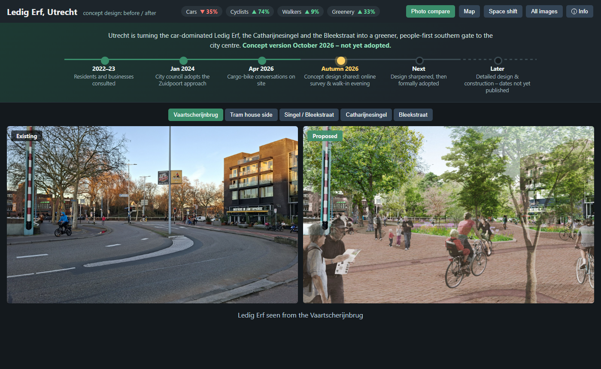
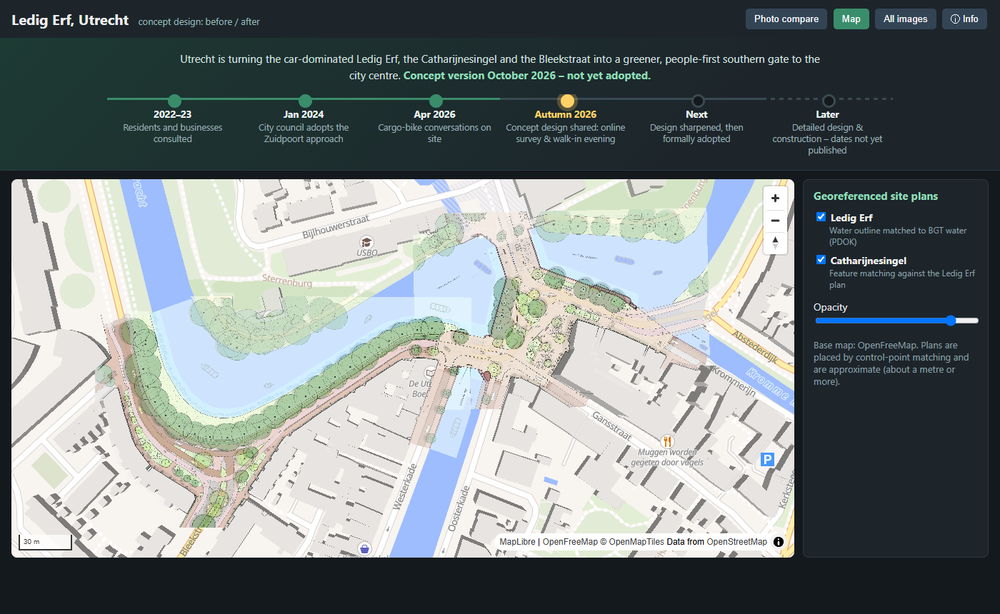
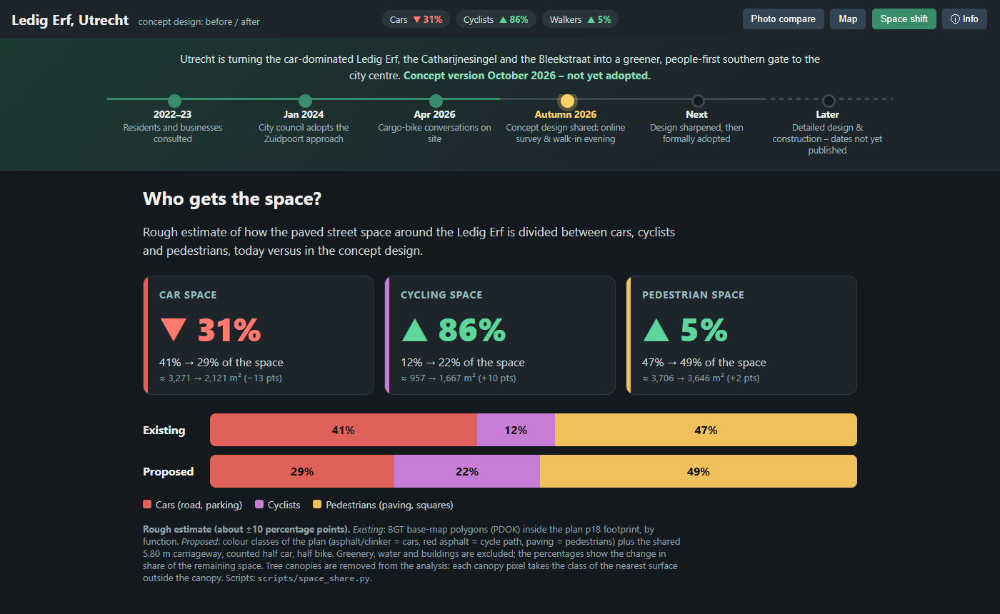

# Ledig Erf – before / after photo viewer

Extracts the images from the concept design note *"Nota van Uitgangspunten en Schetsontwerp Ledig Erf – Bleekstraat"* (Utrecht) and shows them in a static website with existing and proposed photos side by side. Ready for GitHub Pages.

**Live site: <https://bertt.github.io/ledigerf/>**

## Setup

Python via [`uv`](https://docs.astral.sh/uv/):

```powershell
uv sync
```

## Build the images

```powershell
uv run python scripts/extract_pdf.py "Concept Nota van Uitgangspunten en Schetsontwerp Ledig Erf – Bleekstraat.pdf"
uv run python scripts/make_gallery.py      # web JPEGs + docs/images/gallery.json
```

`extract_pdf.py` writes the embedded images and page renders to `work/pdf/` (git-ignored); `make_gallery.py` selects the relevant ones and writes web-sized JPEGs to `docs/images/`.

## Website

`docs/` is a static site with five tabs:

- **Photo compare** (default) – existing and proposed photos side by side for each pair.
- **Map** – MapLibre map (OpenFreeMap base) with the georeferenced site plans of Ledig Erf (p18) and Catharijnesingel (p30) as overlays; toggle and opacity controls.
- **Permanent links** – every tab has its own URL: [`#compare`](https://bertt.github.io/ledigerf/#compare), [`#map`](https://bertt.github.io/ledigerf/#map), [`#space`](https://bertt.github.io/ledigerf/#space), [`#gallery`](https://bertt.github.io/ledigerf/#gallery), [`#info`](https://bertt.github.io/ledigerf/#info). The address bar updates when switching tabs, and back/forward works.
- **Space shift** – rough estimate of the share of space for cars, cyclists, pedestrians and greenery, existing vs. proposed.
- **All images** – gallery of all extracted images with a lightbox.
- **Info** – short English summary of what is planned at Ledig Erf, with a link to the project page.

```powershell
uv run python -m http.server 8000 -d docs     # http://localhost:8000
```

## Screenshots

**Photo compare**



**Map** (georeferenced site plans on OpenFreeMap)



**Space shift** (rough estimate)



## Space shift estimate

```powershell
uv run python scripts/space_share.py work/pdf/images/p18_0.png work/geo_p18.json   # writes docs/images/space.json
```

A rough estimate (about ±10 percentage points) of how public space is divided between cars, cyclists, pedestrians and greenery around the Ledig Erf. *Existing* comes from BGT polygons (PDOK) by function inside the p18 footprint; *proposed* from colour classes of plan p18 (legend) plus the 5.80 m shared carriageway traced on the plan and counted half car, half bike. Water and buildings are excluded. Tree canopies are removed: each canopy pixel takes the class of the nearest surface outside the canopy. Result: car space ≈ −35 % (34 % → 22 % of the space), cycling space ≈ +74 % (10 % → 17 %), pedestrians and green together ≈ +9 % (56 % → 60 %; paving alone is about unchanged), greenery ≈ +33 % (17 % → 22 %).

## Georeferencing the site plans

```powershell
uv run python scripts/georeference.py work/pdf/images/p18_0.png p18          # water outline vs. BGT water (PDOK)
uv run python scripts/match_plans.py work/pdf/images/p18_0.png work/geo_p18.json work/pdf/images/p30_0.png p30   # SIFT feature matching against p18
uv run python scripts/export_georef.py     # transparent WebP overlays + docs/images/georef.json
```

- **p18** is placed by matching its blue water areas to the BGT water polygons (scale, rotation, translation search; Dice 0.68, ≈5.5 cm/px). Bridges and the plan's simplified water cause some mismatch.
- **p30** has little water in common with the BGT, so it is matched to the already georeferenced p18 through shared features (SIFT + RANSAC, 47 inliers, ≈7 cm/px). The overlay against BGT water was checked visually.
- The results are stored in [`georef/`](georef/) as standard world files (`p18.pgw`, `p30.pgw`, with `.prj` = EPSG:28992) plus a `.json` with the affine transform and corner coordinates. Extract the PDF images with `scripts/extract_pdf.py` (`p18_0.png`, `p30_0.png`) and load them in QGIS/GDAL next to the `.pgw` to reuse the georeferencing without re-running the matching. `uv run python scripts/save_georef.py` regenerates these files from `work/geo_*.json`.
- Both results are also exported as four corner coordinates (WGS84) used by MapLibre image sources. Accuracy is roughly a metre or more; the plans are stylised drawings.

## GitHub Pages

*Settings → Pages → Deploy from branch → `main` / `docs`*. All paths are relative.

## Notes

- The PDF is a concept document; check its copyright before publishing the images.
